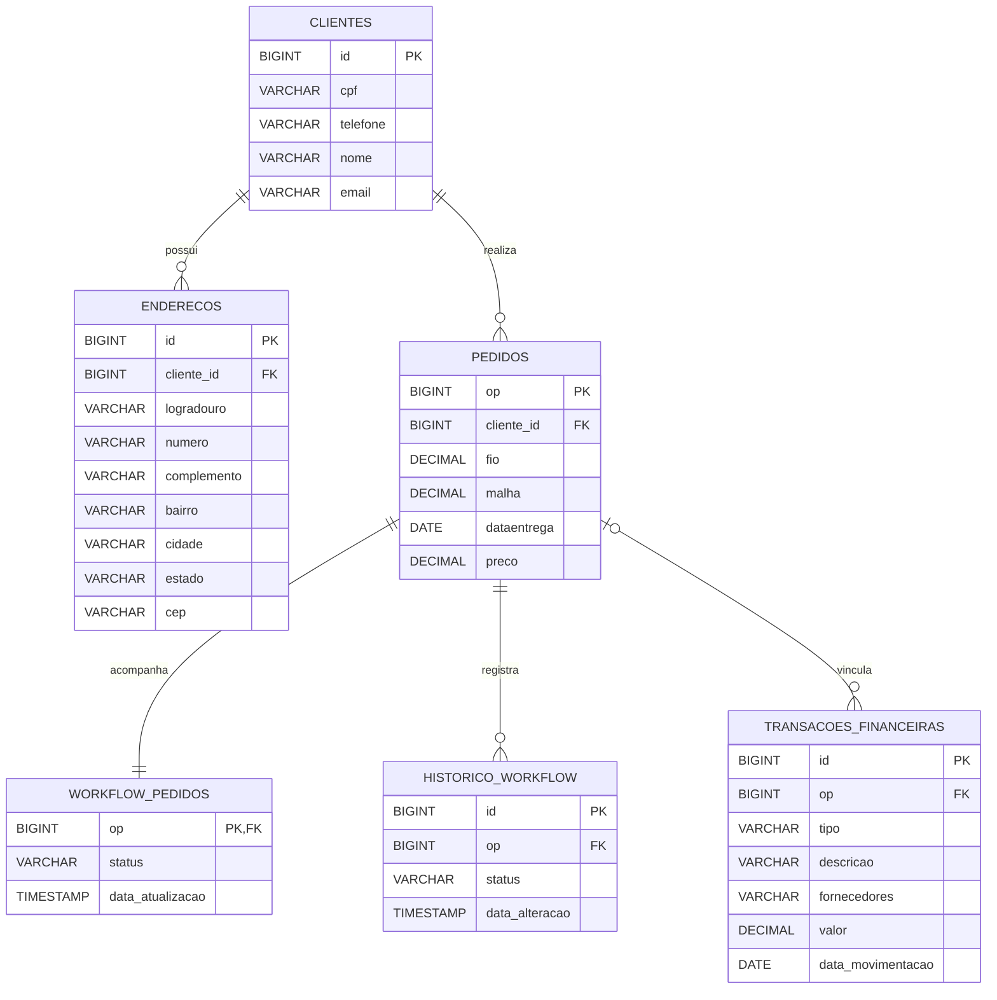

# Diagrama Entidade-Relacionamento (DER) — ProGest

## 1. Visão geral

O banco de dados do ProGest é composto por quatro módulos principais:

- **Clientes:** cadastro de clientes e endereços.
- **Pedidos:** gerenciamento das ordens de produção (OP).
- **Workflow:** acompanhamento do andamento dos pedidos.
- **Financeiro:** controle de entradas, saídas e fornecedores.

## 2. Diagrama Entidade-Relacionamento

## 3. Descrição das entidades

### CLIENTES
Armazena as informações dos clientes cadastrados no sistema.

- `id`: chave primária.
- `cpf`: CPF do cliente.
- `telefone`: telefone de contato.
- `nome`: nome completo.
- `email`: endereço de e-mail.

### ENDERECOS
Armazena os endereços associados aos clientes.

- `id`: chave primária.
- `cliente_id`: chave estrangeira para CLIENTES.
- `logradouro`, `numero`, `complemento`, `bairro`, `cidade`, `estado` e `cep`: dados do endereço.

### PEDIDOS
Armazena as ordens de produção e os dados comerciais dos pedidos.

- `op`: chave primária e identificador da Ordem de Produção.
- `cliente_id`: chave estrangeira para CLIENTES.
- `fio`: quantidade de fio utilizada na fabricação.
- `malha`: quantidade de malha utilizada na fabricação.
- `dataentrega`: data de entrega do pedido.
- `preco`: valor total da venda.

### WORKFLOW_PEDIDOS
Armazena o status atual de cada pedido.

Status possíveis:
- `A_FAZER`
- `EM_PROCESSO`
- `ENTREGUE`

A coluna `op` é simultaneamente chave primária e chave estrangeira para PEDIDOS.

### HISTORICO_WORKFLOW
Registra as alterações de status dos pedidos.

- `id`: chave primária.
- `op`: chave estrangeira para PEDIDOS.
- `status`: situação registrada.
- `data_alteracao`: data e hora da alteração.

### TRANSACOES_FINANCEIRAS
Armazena todas as movimentações financeiras.

- `id`: chave primária.
- `op`: chave estrangeira opcional para PEDIDOS.
- `tipo`: ENTRADA ou SAIDA.
- `descricao`: descrição da movimentação.
- `fornecedores`: fornecedor relacionado à movimentação.
- `valor`: valor financeiro.
- `data_movimentacao`: data do recebimento ou pagamento.

## 4. Regras de relacionamento

| Relacionamento | Cardinalidade |
|---|---|
| CLIENTES → ENDERECOS | 1:N |
| CLIENTES → PEDIDOS | 1:N |
| PEDIDOS → WORKFLOW_PEDIDOS | 1:1 |
| PEDIDOS → HISTORICO_WORKFLOW | 1:N |
| PEDIDOS → TRANSACOES_FINANCEIRAS | 1:N opcional |

## 5. Regras de negócio

1. Cada pedido possui uma OP única.
2. Cada pedido pertence a um cliente.
3. Ao cadastrar um pedido, seu workflow deve iniciar em `A_FAZER`.
4. As alterações de status devem ser registradas no histórico.
5. Um pedido pode possuir várias transações financeiras, permitindo pagamentos parcelados.
6. Uma transação pode ser cadastrada sem OP, representando uma movimentação sem vínculo com pedido.
7. Na regra automática atual, transações com OP são classificadas como `ENTRADA`, enquanto transações sem OP são classificadas como `SAIDA`.
8. O campo `preco` representa o valor total da venda do pedido, não o valor de cada parcela.

## 6. Observação técnica

Este DER representa a estrutura lógica planejada para o ProGest.

Antes de utilizá-lo como documentação definitiva do banco, confirme se todas as entidades, colunas e chaves estrangeiras estão implementadas no `schema.sql` e nas classes JPA correspondentes.
