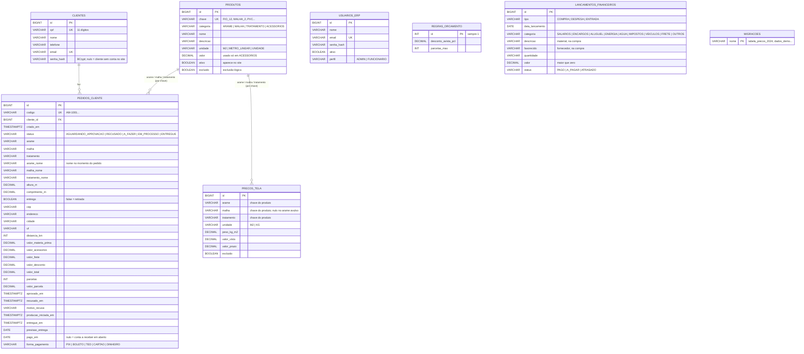
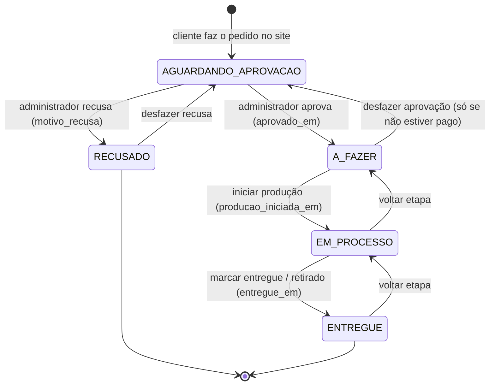
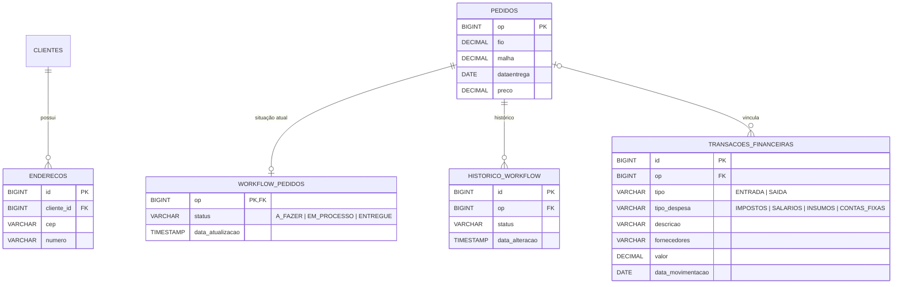

# Diagrama do Banco de Dados (DER): ProGest

Modelo do banco usado pela API (`backend/Backend_api`). O mesmo `schema.sql` cria as tabelas no **H2** (local) e no **PostgreSQL/Supabase** (produção) a cada início do backend, sem apagar dados.

Fonte: [`backend/Backend_api/src/main/resources/schema.sql`](../backend/Backend_api/src/main/resources/schema.sql).

Imagens prontas (PNG/SVG) em [`docs/diagramas/`](diagramas/).

## Visão geral

| Módulo | Tabelas em uso | Para que serve |
|---|---|---|
| Clientes e acesso | `clientes`, `usuarios_erp` | Contas do site (por CPF) e usuários do painel (ADMIN / FUNCIONARIO) |
| Catálogo e preços | `produtos`, `precos_tela`, `regras_orcamento` | Opções do configurador, preço por combinação e regras de desconto/parcelas |
| Pedidos | `pedidos_cliente` | Pedido do site: valores, entrega, workflow (aprovação → produção → entrega) e pagamento |
| Financeiro | `lancamentos_financeiros` (+ pagamento em `pedidos_cliente`) | Compras de material, saídas e vendas diretas |
| Controle | `migracoes` | Marca as cargas de dados que só podem rodar uma vez |

## Diagrama (tabelas em uso)

> **Ligação por chave:** `precos_tela` e `pedidos_cliente` guardam a `chave` do produto (ex.: `FIO_12`), sem chave estrangeira. Assim o pedido continua válido se o produto for excluído; por isso o pedido também guarda o nome (`arame_nome`, `malha_nome`, `tratamento_nome`).

## Ciclo de vida do pedido (`pedidos_cliente.status`)

O pagamento é independente das etapas: a partir da aprovação o pedido aparece em **Contas a receber** (prazo de 15 dias) até alguém registrar `pago_em` no Financeiro.

## Tabelas antigas (não usadas pelas telas)

Criadas no começo do projeto, antes do fluxo atual. Continuam no `schema.sql`, mas nenhuma tela usa e as rotas delas (`/api/clientes`, `/api/pedidos`, `/api/workflow`, `/api/financeiro`) exigem login de administrador. A remoção está numa issue própria.

| Tabela antiga | Substituída por |
|---|---|
| `pedidos`, `workflow_pedidos`, `historico_workflow` | `pedidos_cliente` (status e datas de cada etapa na própria linha) |
| `enderecos` | Endereço de entrega gravado no pedido (`cep`, `endereco`, `cidade`, `uf`) |
| `transacoes_financeiras` | `lancamentos_financeiros` + pagamento em `pedidos_cliente` |
