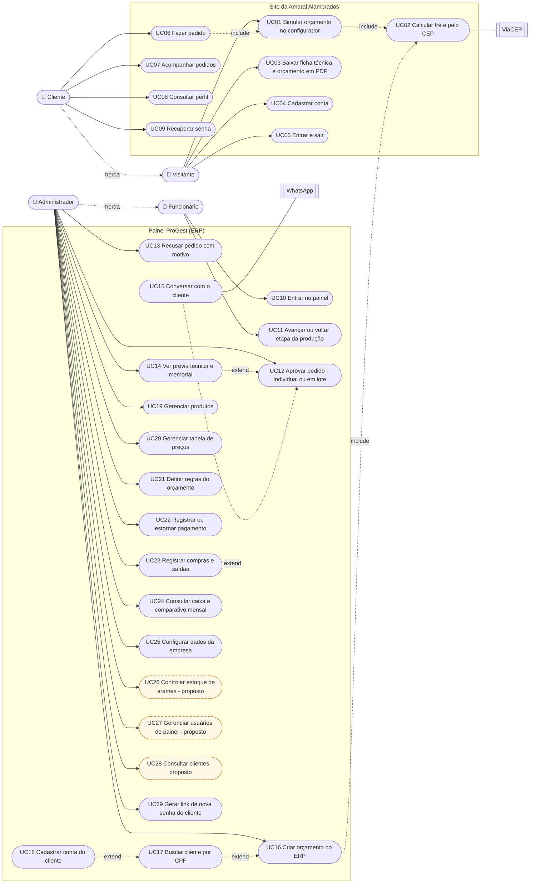
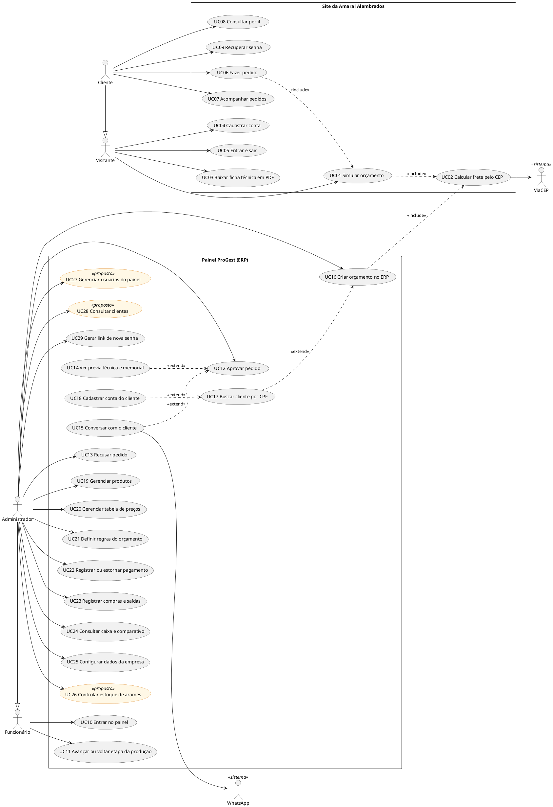

# Diagrama de Casos de Uso: ProGest

Casos de uso do sistema como ele funciona hoje: o **site da Amaral Alambrados** (cliente) e o **painel ProGest** (ERP), ligados à mesma API.

Os casos marcados como **(proposto)** ainda não existem e têm issue aberta no GitHub.

## Atores

| Ator | Quem é | Onde atua |
|---|---|---|
| **Visitante** | Qualquer pessoa no site, sem login | Site |
| **Cliente** | Visitante com conta (cadastro por CPF). Herda tudo do Visitante | Site |
| **Funcionário** | Equipe da fábrica com perfil `FUNCIONARIO`. Só acessa Produção e Entregas | ERP |
| **Administrador** | Equipe com perfil `ADMIN`. Herda tudo do Funcionário e acessa todas as telas | ERP |
| **ViaCEP** (sistema externo) | API pública que devolve o endereço a partir do CEP | Site e ERP |
| **WhatsApp** (sistema externo) | Conversa com o cliente aberta pelo ERP | ERP |

## Diagrama

> O GitHub desenha o diagrama abaixo (Mermaid). Imagens prontas (PNG/SVG), separadas em site e ERP, ficam em [`docs/diagramas/`](diagramas/). Para a notação UML completa, use a versão em PlantUML no fim da página.

## Descrição resumida dos casos de uso

| Código | Caso de uso | Ator | Regras principais |
|---|---|---|---|
| UC01 | Simular orçamento | Visitante | Escolhe arame, malha (só as que têm preço com o arame), tratamento e medidas (altura de 1 a 6 m, comprimento de 10 a 10.000 m). O valor é calculado pela API (`POST /api/orcamento`) com a tabela de preços do ERP. |
| UC02 | Calcular frete pelo CEP | Visitante | Endereço pelo ViaCEP; frete = combustível por km + pedágio acima de 25 km + taxa base. Retirada na fábrica não tem frete. |
| UC03 | Baixar ficha técnica e orçamento em PDF | Visitante | Gera o PDF com a especificação e os valores da simulação. |
| UC04 | Cadastrar conta | Visitante | Nome, CPF válido e único, telefone, e-mail único e senha de 8 a 72 caracteres. |
| UC05 | Entrar e sair | Visitante / Cliente | Login por e-mail e senha; a sessão fica num token. |
| UC06 | Fazer pedido | Cliente | Só com login. Grava o pedido como **Aguardando aprovação**, com os valores recalculados no backend e o nome dos produtos no momento do pedido. |
| UC07 | Acompanhar pedidos | Cliente | Linha do tempo: Aprovação → Pagamento → Produção → Aguardando entrega/retirada → Finalizado. Pedido recusado mostra o motivo. |
| UC08 | Consultar perfil | Cliente | Mostra os dados do cadastro com o CPF parcialmente oculto. |
| UC09 | Recuperar senha | Cliente | "Esqueceu a senha?": link de uso único por e-mail, válido por 30 minutos. A resposta é igual com ou sem conta, no máximo 3 e-mails a cada 15 minutos, e trocar a senha encerra as sessões abertas. |
| UC10 | Entrar no painel | Funcionário | Usuários separados dos clientes (`usuarios_erp`). Admin abre em Aprovação; funcionário em Produção. |
| UC11 | Avançar ou voltar etapa | Funcionário | A fazer → Em produção → Entregue. Não pula etapas (validação no backend). |
| UC12 | Aprovar pedido | Administrador | Individual ou em lote. O pedido vai para **A fazer** e abre uma conta a receber de 15 dias. |
| UC13 | Recusar pedido | Administrador | Motivo opcional, exibido para o cliente. |
| UC14 | Ver prévia técnica | Administrador | Desenho automático da tela, consumo de aço, tempo de tear, veículo sugerido e memorial descritivo para baixar. |
| UC15 | Conversar com o cliente | Administrador | Abre o WhatsApp com uma mensagem sobre o pedido. |
| UC16 | Criar orçamento no ERP | Administrador | Mesmo cálculo do site; cliente por CPF, novo ou sem cadastro; salva em PDF. |
| UC17 / UC18 | Buscar cliente / cadastrar conta | Administrador | CPF enviado no corpo da requisição; a conta criada já entra no site. |
| UC19 | Gerenciar produtos | Administrador | Arame, malha, tratamento e acessórios. Ativo = aparece no site. Exclusão lógica (`excluido`). |
| UC20 | Gerenciar tabela de preços | Administrador | Preço por combinação arame + malha + tratamento, por m² (vira opção no site) ou por kg (arame avulso). |
| UC21 | Definir regras do orçamento | Administrador | Desconto à vista (0 a 50%) e parcelas máximas (1 a 24). |
| UC22 | Registrar ou estornar pagamento | Administrador | Data e forma (PIX, boleto, TED, cartão, dinheiro). O valor entra nas entradas do mês e o cliente vê o pagamento confirmado. |
| UC23 | Registrar compras e saídas | Administrador | Compras de material (fornecedor) e saídas por categoria, com status Pago, A pagar ou Atrasado. |
| UC24 | Consultar caixa e comparativo | Administrador | Vendas, entradas, saídas e saldo do mês; comparativo dos últimos 6 meses. |
| UC25 | Configurar dados da empresa | Administrador | Razão social, CNPJ, WhatsApp e origem do frete (hoje ficam só no navegador). |
| UC29 | Gerar link de nova senha do cliente | Administrador | No Novo orçamento, depois de buscar o cliente: link válido por 24 horas para copiar ou enviar pelo WhatsApp. Funciona sem e-mail configurado. |
| UC26–UC28 | Propostos | — | Ver as issues abertas no GitHub. |

## Versão PlantUML (notação UML para a documentação)

Cole em [plantuml.com/plantuml](https://www.plantuml.com/plantuml) ou use a extensão PlantUML do VS Code para exportar em PNG/SVG.

